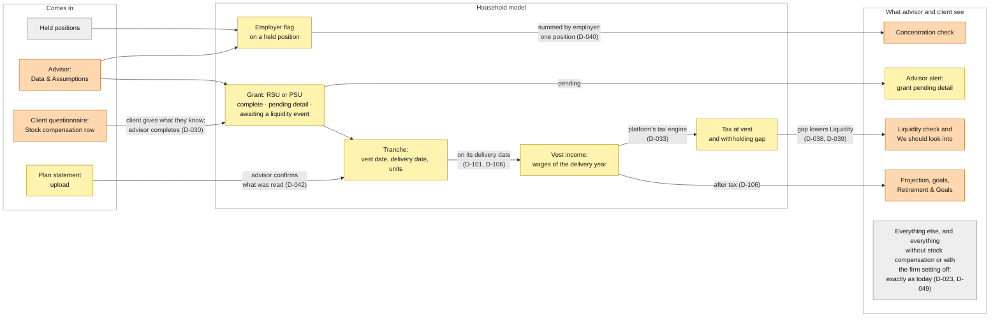

# Spec index · stock compensation MVP

The feature specs for the MVP: what the system does, checked by tests. Product owns the what and why; engineering owns the plan and tasks; QA verifies against the acceptance criteria (D-004, D-047). Success criteria and their targets live in `../07_success_criteria.md` (D-043). Method: `.claude/skills/spec/SKILL.md`. 2026-10-05.

## How to read a feature

- Each feature is one advisor outcome that can be tested and released on its own (D-047).
- Requirements are EARS lines with an ID (`AC-A-01`: feature A, line 01), the decision they come from and the prototype tests that show they can be built and tested (see Traceability).
- Edge cases (`EC-A-01`) resolve to a requirement or are out of the MVP with their decision.
- Instrumentation events (`EV-A-01`) feed the metrics in `07_success_criteria.md`.
- `pending D-…` marks a line that waits for a decision not yet confirmed.
- A line with more than one clause passes only when every clause passes.
- Parameters `P-…` are parts of the score that are not public [brief]; their test values are SIMULATED.

## Roles

| Role | Owns |
|---|---|
| Product | These specs, the success criteria, acceptance of each feature |
| Engineering | The plan and tasks for each feature, how it is built (D-004) |
| QA | Verification against the acceptance criteria |

The prototype pull request (F6) is a reference implementation that shows the spec holds up; it is not the plan (D-004).

## Working from this spec

- Product defines what the system does; how and at what level each requirement is verified is QA's and engineering's call (D-121). The Test column only shows how the prototype proved a line can be tested.
- Teams that automate tests can keep the same trace: start each test title with the IDs it proves, and `npm run trace` in `prototype/` lists every requirement with its tests.
- Each feature also has a Notion page in the GitHub Spec Kit template (D-122). Its requirements are these, word for word and with these IDs; its acceptance scenarios are key examples, each citing the `EC-` and `AC-` IDs it comes from. Where the two differ, this repo is right.
- The edge cases of each feature (`EC-…`) are product's full set of examples, with the situation, the expected result and the criteria they cover; with the prototype's tests, they live only in this repo. QA builds its own test cases from them and from the criteria.

| Notion (Spec Kit) | This repo |
|---|---|
| User Story, Why this priority, Independent Test | User story and Context of the feature file |
| Acceptance Scenarios | Edge cases (`EC-`) and the requirements they cite |
| Edge Cases | Edge cases (`EC-`) |
| Functional Requirements | Requirements (`AC-`), with the Test column |
| Key Entities | Shared data, in this index |
| Success Criteria | Instrumentation (`EV-`) and `../07_success_criteria.md` (`M-`) |
| Assumptions | `[ASSUMPTION: A-NN]` tags and `../02_open_questions.md` |
- Engineering owns the plan: how to split each feature into stories and tasks, and in what order. The requirement groups inside a feature (for example in F-B: Grant, Schedule, PSU, Private employer, What the analysis shows, Completeness) are natural split points; the release order is in Features below.
- A requirement that cannot be built as written comes back to product as a change with its ID, not a fix in code.

## Definition of done (proposed; the team agrees it, D-121)

A feature is done when:

1. Every acceptance criterion passes as a test case, verified by QA on the production build.
2. Every instrumentation event is recorded and visible where the pilot metrics are read.
3. A household without stock compensation, or a firm with the setting off, gets exactly today's output (G).

## Formats and terms used in every line

| In a line | Means | Example |
|---|---|---|
| `$<X>` and every amount | US dollars, rounded to the nearest whole dollar, comma for thousands | $54,120 |
| `<Y>%` and every share | Whole percent, rounded to the nearest | 30% |
| `<date>`, `<vest date>`, `<analysis date>` and every date | Month in full, day, year, in English, whatever the browser's language | June 1, 2027 |
| `<month year …>` | Month in full and year | June 2027 |
| `<Company>`, `<company>`, `<Name>`, `<goal>`, `<grant>`, `<ticker>`, `<document>` | The value as recorded, unchanged | Halden Robotics |
| `<n>`, `<m>`, `<accounts>`, `<year>`, `<Year>` | Whole number, comma for thousands; years without it | 1,600 of 2,000 units; 2028 |
| Exactly as today | The same screens, figures, lines and score the current release produces for the same household data; QA checks it against the current release | |

## How the model changes

What comes in, what the household model adds, and what the advisor and the client see. Yellow is new, orange is an existing part that changes, grey is unchanged; each arrow carries the decision behind it. Release 1 is the employer flag and the concentration check (F-A); release 2 is everything else (D-080, D-106).

## G · Rules for every feature

| ID | Requirement (EARS) | From | Test |
|---|---|---|---|
| AC-G-01 | Where the firm has not enabled stock compensation, the system shall show the questionnaire, the analysis and the score exactly as today. | D-023, D-030 | unit F-A, unit F-E, component F-A, component F-E |
| AC-G-02 | Where the firm has enabled stock compensation, the system shall add to the questionnaire only the "Stock compensation" income chip and its helper line; a household that adds no stock compensation row sees no new question. | D-023, D-030, D-056 | component F-E |
| AC-G-03 | While a household has no grant and no position flagged as employer stock, the system shall compute every score check, figure and report line exactly as today. | D-023 | unit F-A, unit F-C, unit F-E |
| AC-G-04 | The system shall leave out of every score figure any grant that is pending detail. | D-035, D-039 | unit F-D |
| AC-G-05 | The system shall leave out of every score figure any grant or share of a private employer. | D-025, D-039 | unit F-B, unit F-D |
| AC-G-06 | The system shall phrase every new report line as a fact about the household, without a sell, hold, exercise or tax instruction. | D-041 (personalised advice: never); A-04 | spec only (see index) |
| AC-G-07 | The system shall let the advisor edit or delete every new report line before sharing, as for other generated lines. | [web: https://sherpaswealth.com/financial-health, advisors edit generated observations] | unit G, component G |
| AC-G-10 | The system shall show every new client-facing line with the same text in the live client view and in the shared PDF, including the advisor's edits and, for performance units, the range beside the number. | D-045, D-060 | unit G, component F-A, component G, e2e h2 |
| AC-G-11 | The system shall show the advisor notices of AC-A-08, AC-B-10, AC-B-12, AC-B-30, AC-C-13, AC-E-16, AC-E-17, AC-F-08, AC-F-12, AC-F-17 and AC-G-19, the client's estimates (AC-E-14) and proposed grants only in advisor mode and Data & Assumptions, never in the client view or the shared PDF. | D-060; [FACT: platform_map, the client sees the analysis live] | unit F-E, component F-A, component F-B, component F-E, e2e h2 |
| AC-G-12 | When the advisor saves any stock-compensation change (a flag, a grant, a tranche, a state withholding rate, the income question, a confirmed extraction), the system shall reprocess the analysis and, if it has a manual score adjustment, first show the warning of AC-B-06. | [brief]; D-049, D-060 | component F-A, component G, e2e h2 |
| AC-G-13 | When Sherpas turns the setting off for a firm, the system shall keep its stock-compensation data, hide it and leave it out of every figure from the next reprocessing, leaving analyses already generated and PDFs already shared unchanged; turning the setting on again shall restore it. | D-030, D-060, D-111 | unit F-A, component F-A |
| AC-G-14 | The system shall add no new score limit; existing limits read the checks as today. | D-039, D-060 | unit G |
| AC-G-15 | The system shall label every value of a future vest with the price date: "at the <analysis date> price". | D-045, D-060 | unit F-B, unit F-D, component F-B, component F-D |
| AC-G-16 | The system shall compute the savings rate, fixed commitments, debt-to-income, housing ratio, life cover need, Social Security estimate, contributions, the Summary income card and the cash flow statement totals from reported income as today, never adding vest income, including the income the projection reads (AC-D-01). | D-054, D-107 [ASSUMPTION: A-62] | unit F-C |
| AC-G-17 | The paragraphs the platform writes for each section of Financial health, for the Investment analysis tab (limited there to the employer stock line of AC-A-22) and for the score explanation shall use the stock-compensation facts of the new lines (AC-A-14 to AC-A-16, AC-C-23, AC-C-24, AC-D-06, AC-D-07, AC-D-11, AC-E-10) the way they use other holdings and figures today, never contradicting those lines, carrying the AC-D-11 label when they quote a projection figure, and phrased as AC-G-06 requires. | D-075, D-097, D-110 | spec only (see index) |
| AC-G-18 | In the first release, the system shall let only Sherpas turn the firm setting on or off, and show firm admins its state. | D-043, D-111 | spec only (see index) |
| AC-G-19 | When the setting is turned off for a firm, the system shall show the advisor, in each household with a grant, "Income was reported without stock compensation. Check the salary on file." | D-111 | spec only (see index) |
| EV-G-01 | When an analysis of a household with stock compensation is shared, the system shall record the firm, the household and the status of each grant (complete, pending detail, awaiting a liquidity event). | D-088; M-07, M-08 | spec only (see index) |

One firm setting, "stock compensation", turns everything on or off for a firm; in the first release Sherpas turns it on and off for the pilot firms, and firm admins only see its state (D-030, D-043, D-049, D-111). Firm admins turning it on and off themselves is Next. The stock-compensation question always ships with the feature: it is how stock compensation enters from the client (D-030, D-032).

## Existing households

Households analysed before a firm turns the setting on have no stock-compensation data. Handling (D-052):

| ID | Requirement (EARS) | From | Test |
|---|---|---|---|
| AC-G-08 | When a firm turns the setting on, the system shall change no existing analysis until the advisor adds a flag or a grant. | D-023, D-052 | component F-B |
| AC-G-09 | The system shall let the advisor add flags, grants and plan statements to an existing household through advisor mode and Data & Assumptions (F-A, F-B, F-F). | D-030, D-042, D-052 | component F-B, e2e h2 |

After the MVP (D-052): asking existing clients the stock-compensation question without the full questionnaire [ASSUMPTION: A-22]; suggesting to the advisor existing households that hold single stocks; year-by-year follow-up (D-037 next).

## Features

| Feature | Advisor outcome | Decisions | Depends on | Release order |
|---|---|---|---|---|
| [F-A](F-A_employer-stock-concentration.md) | Concentration sees employer stock as one position, and View more shows the double exposure | D-024, D-040, D-044, D-045 | none | 1 |
| [F-B](F-B_record-grant-and-vests.md) | The advisor records an RSU or PSU grant and sees its future vests | D-024 to D-027, D-029, D-025, D-036, D-037, D-045, D-058 | none (F-A for the context lines) | 2 |
| [F-C](F-C_tax-at-vest.md) | Tax at each vest and the withholding gap; Liquidity counts it | D-033, D-038, D-039 | F-B | 2 |
| [F-D](F-D_vest-proceeds-dated-cash.md) | Vest proceeds as dated cash beside the goals | D-038, D-039, D-045 | F-B | 2 (with the projection, D-106) |
| [F-E](F-E_client-reports-stock-compensation.md) | The client reports stock compensation in Income with a chip; the grant stays pending and the opportunity shows an alert | D-028, D-030, D-031, D-035, D-036, D-056, D-057 | F-B | 2 |
| [F-F](F-F_upload-plan-statement.md) | The advisor or the client uploads a plan statement; the advisor confirms the extracted tranches | D-042, D-057 | F-B | 2 |

## First release and Next (D-080)

Release 1 is F-A; release 2 is F-B, F-C, F-D (with the projection, D-106), F-E and F-F, together. These requirements are for the release after (Next); they stay specified, carry "Next (D-080)" in their From cell, and the prototype keeps them, labelled: AC-A-03, AC-B-14, AC-B-20, AC-B-21.

## Shared data

Described in product terms; field names and storage are engineering's call. The platform's type lists already hold a stock compensation asset category (sub-type RSU used here) and a stock compensation income category (RSU inflow used here); grants and vest income map onto them, and what the lists do not hold (PSU terms, tranches, status, the employer flag) is added (D-058) [ASSUMPTION: A-12].

| Object | Holds | From |
|---|---|---|
| Employer | Name; listed or private; ticker when listed; latest 409A value and its date, when private and known | D-025, D-031 |
| Employer flag on a held position | Employer; person whose employer it is; current employer: yes, no or unknown; cost basis when known | D-024, D-029, D-031 |
| Grant | Owner (one person, never joint); type (RSU, or PSU: an RSU with performance terms); employer; grant date; units; status (complete, pending detail, awaiting a liquidity event); source (advisor, questionnaire, extraction) | D-024 to D-027, D-035, D-042 |
| PSU terms | Performance condition; end of the performance period; payout range, 0% to 200% of target unless the award says otherwise | D-027; R-002, R-011; SC-05 |
| Tranche | Vest date; units (PSU: target units); shares kept after withholding and cost basis, when known | D-027, D-029 |

## Score simulator parameters

The simulator reproduces only what the score article makes public [brief]; everything else is a parameter.

| Parameter | What it is | Public? | Simulator value |
|---|---|---|---|
| Check scale | Each check turns one figure into 0 to 100, on a scale, not pass or fail | Yes [brief] | As stated |
| Area weights | Building wealth 30/20/20/15/15; retirement 25/10/20/20/25 (cash flow, debt, protection, liquidity, investing) | Yes [brief] | As stated |
| Missing data | A figure Sherpas does not have is left out, not treated as zero or average | Yes [brief] | As stated |
| `P-CONC` | Curve of the Investing concentration check | No | SIMULATED, [ASSUMPTION: A-31]; R-014's 10% is reference only (SC-29) |
| `P-CONC-BASE` | The base of the concentration figure ("investable assets") | Name only [FACT: captures/client/02-score-breakdown] | SIMULATED: listed investments plus cash [ASSUMPTION: A-31] |
| `P-LIQ-HORIZON` | What "near-term" means in the Liquidity commitments check | No | SIMULATED, [ASSUMPTION: A-31] |
| `P-LIQ` | Curve of the near-term commitments check | No | SIMULATED, [ASSUMPTION: A-31] |
| `P-AREA-MIX` | How the check scores of one area combine into its points | No | SIMULATED: equal weights, [ASSUMPTION: A-31] (D-066) |
| `P-VEST-SAVE` | The share of a vest, after its tax, the projection saves, treating the vest as wages of its year (AC-D-10) | No | SIMULATED: the household's own saving rate on its reported salary, the rest spent as wages are [ASSUMPTION: A-62] (D-118) |
| `P-STAGE` | Weights of a household in transition | No ("values in between") | SIMULATED [ASSUMPTION: A-31] |
| `P-LIMITS` | Serious issues that hold the score down | No | Left out of the simulator, labelled [ASSUMPTION: A-31] |

Simulator tests are relations, not absolute scores (see each feature).

## Metrics fed (defined in `07_success_criteria.md`)

| ID | Metric |
|---|---|
| M-01 | Proposal conversion and time to proposal, households with stock compensation against those without (read, not a gate) |
| M-02 | Share of households with stock compensation whose detail is complete within N days |
| M-03 | Share of extracted tranches confirmed without edits |
| M-04 | Manual score adjustment rate, households with employer exposure against the rest, with the reason |
| M-05 | Share of analyses with stock compensation shared without edits to the new lines |
| M-06 | Firms that enable the setting; share of their households with stock compensation |
| M-07 | Share of analyses of households with stock compensation shared with every grant complete (primary, release 2) |
| M-08 | Advisor actions per household with stock compensation, from the questionnaire to the first share |
| GR-01 | Guardrail: questionnaire completion rate and time, households without stock compensation (D-023) |
| GR-02 | Guardrail: retention of pilot firms, at renewal |

## Traceability

### What the prototype's tests check, and why

The tests show that each requirement is precise enough to build and to test as written (D-004, D-119). They are product's check of its own spec, not QA: QA verifies the production build against the same IDs, and engineering writes its own tests (Roles, above). A requirement the prototype could not build as written went back to the spec as a gap (`../10_flow_review.md`).

| Layer | What is tested | How | Why it matters |
|---|---|---|---|
| Business rules | Score checks with employer stock, tax at vest and the withholding gap, vests as dated cash, duplicate and complete grants | Unit tests: relations (flagging employer stock never raises the score) and the spec's own examples | These are the figures advisor and client read; a wrong figure is the most serious failure |
| Data model | A grant, its tranches, vest and delivery dates, the employer-stock flag, a statement completing a grant | Unit tests | Every screen and figure reads it |
| User flows | Client's Income chip, advisor editors, confirm and undo, analysis, shared and printed view | Component tests on rendered screens; one browser walk of H2 from questionnaire to shared view | The screens connect, and advisor-only lines never reach the client (AC-G-11) |
| Events | Each instrumentation event fires with its fields | Unit tests | They feed the pilot metrics |

Not tested here: Sherpas' real score curves and thresholds (SIMULATED `P-` parameters), the platform's tax engine, look and layout, performance, accessibility, security. These belong to engineering and QA on the real build.

### Requirements against tests

<!-- trace:start · generated by `npm run trace -- --write`; do not edit by hand -->
| Feature | Requirements and events | Tested | Spec only | Test files |
|---|---|---|---|---|
| G · Rules for every feature | 20 | 15 | 5 | unit F-A, unit F-B, unit F-C, unit F-D, unit F-E, unit G, component F-A, component F-B, component F-D, component F-E, component G, e2e h2 |
| F-A · Employer stock counted in concentration | 27 | 27 | 0 | unit F-A, unit F-B, unit G, component F-A, component F-B, component G |
| F-B · Record a grant and its vests | 36 | 32 | 4 | unit F-B, unit F-F, component F-A, component F-B |
| F-C · Tax at vest and the withholding gap | 34 | 32 | 2 | unit F-C, component F-C |
| F-D · Vest proceeds as dated cash for goals | 12 | 12 | 0 | unit F-D, unit G, component F-D |
| F-E · The client reports stock compensation | 28 | 22 | 6 | unit F-C, unit F-E, component F-B, component F-E, e2e h2 |
| F-F · Upload a plan statement and confirm the extracted tranches | 21 | 20 | 1 | unit F-F, component F-B, component F-F |
| **Total** | 178 | 160 | 18 | |

Spec only, with the reason each is not built in the prototype (D-063):

| ID | Reason |
|---|---|
| `AC-G-06` | wording review, manual; every new line is copied from the spec |
| `AC-G-17` | the prototype does not generate the platform's written paragraphs; the rule stays in the spec (D-097) |
| `AC-G-18` | pilot control in Sherpas' back office; the prototype's firm switch stands in for it |
| `AC-G-19` | pilot-stop notice to advisors, shown only when Sherpas turns the setting off after use |
| `EV-G-01` | share event: instrumentation for the pilot metrics, not shown in the prototype |
| `AC-B-15` | dropped in the spec (D-050) |
| `AC-B-25` | absence of reminders: nothing to build or show (manual) |
| `AC-B-29` | dropped in the spec (D-094) |
| `AC-B-33` | tranches delivered earlier this year (common with quarterly plans, not an edge case): value at delivery not built in the prototype |
| `AC-C-31` | tranches delivered earlier this year: keeping their tax in the year's figures until December not built in the prototype |
| `AC-C-32` | tranches delivered earlier this year: valuing them at the value at delivery not built in the prototype |
| `AC-E-05` | dropped in the spec (D-094) |
| `AC-E-11` | dropped in the spec (D-094) |
| `AC-E-13` | dropped in the spec (D-094) |
| `AC-E-22` | proposals from the questionnaire chat or an "Other income" row need the platform's context mechanism (A-27), which the prototype does not have |
| `AC-E-23` | alert for a chat or "Other income" proposal: depends on AC-E-22 |
| `AC-E-24` | confirming or rejecting a chat or "Other income" proposal: depends on AC-E-22 |
| `AC-F-15` | the prototype has no opportunity documents page; uploads in Data & Assumptions and in the client's documents step use the same processing (AC-F-02, AC-F-13) |

Each requirement row in the feature files names its tests in the Test column: `unit` and `component` are files in `prototype/tests/`, `e2e` is the browser walk in `prototype/e2e/`.
<!-- trace:end -->
